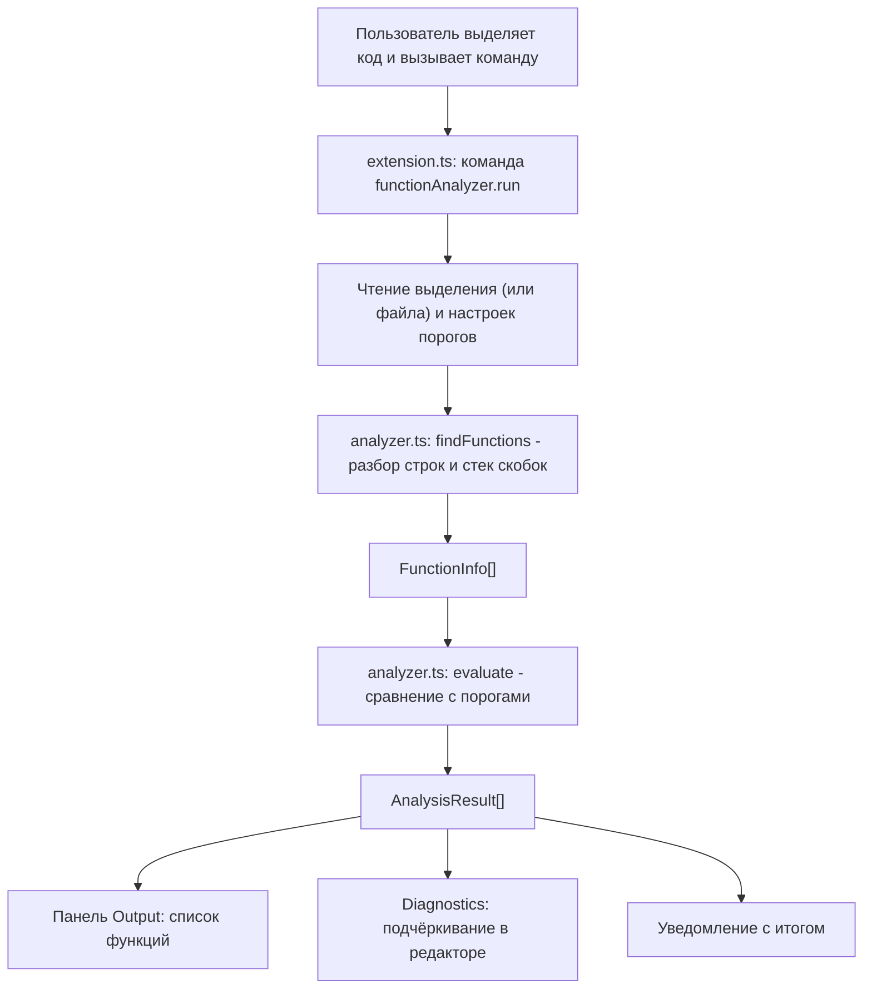

# Архитектура плагина «Function Analyzer»

## Блок-схема

## Модули
- `src/extension.ts` связывает плагин с VS Code: регистрирует команду,
  читает выделение и настройки, выводит результат.
- `src/analyzer.ts` содержит логику разбора и оценки и не зависит от VS Code.

## Структуры данных
- `FunctionInfo` хранит имя, номера первой и последней строки, длину и
  максимальную вложенность функции.
- `Limits` хранит пороги длины и вложенности.
- `AnalysisResult` хранит результат оценки: `FunctionInfo` и флаги
  `tooLong`, `tooDeep`.
- Стек скобок (`number[]`): `1` для скобки тела функции, `0` для остальных.
- `Set` ключевых слов (`if`, `for`, `while` и т.д.), чтобы не принимать
  управляющие конструкции за функции.

## Алгоритм `findFunctions`
1. Строка очищается от строковых литералов и `//`-комментариев.
2. Вне функции ищется заголовок функции регулярным выражением; имя
   запоминается как «ожидающее» (скобка `{` может быть на следующей строке).
3. Для каждого символа строки: `{` кладёт метку в стек (`1` для скобки,
   открывающей тело функции, иначе `0`, и тогда растёт глубина и
   обновляется максимум); `}` извлекает метку.
4. Если извлечена метка `1`, функция закончилась: результат записывается
   в массив.

## Алгоритм `evaluate`
Для каждой функции сравниваются длина и вложенность с порогами и
выставляются флаги `tooLong` и `tooDeep`.